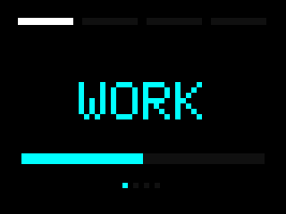

# Arcade Agent Desk

PCで動かしている作業の状態を、Scratch Arcade本体で見る卓上端末です。
WORK・DONE・FAIL・WAIT・LOSTの表示と短い通知音を使います。
送るのは状態や数値だけで、コマンド・ソース・ログ全文は送りません。

[English](README.md)



*実WASMへ合成通知を渡した再生画像です。本体撮影・実ジョブの録画ではありません。*

## 現在の状態

UDP bridge、実コマンドrunner、非公開鍵の生成、鍵ごとのWASMビルドまで実装しました。
実CアプリとWasmtimeで、認証・再送拒否・期限切れを試験しています。
ESP32-S3実機1台でも、状態/描画照合・実終了コードの通知・期限切れ・解放を自動検証しました。
install/connect/disconnectコマンドを用意しました。2回の再接続で15アプリを保持し、
40更新すべてが3秒の照合期限内に反映されました。実LCD・物理キー・聴取は未確認です。

## ホストで試す

```sh
uv sync --locked
uv run --locked python -m arcade_agent_desk pair --key secrets/pairing.json
uv run --locked python -m arcade_agent_desk build \
  --sdk ../scratch-arcade-os --key secrets/pairing.json --output build/paired
uv run --locked python -m arcade_agent_desk run --key secrets/pairing.json \
  --timeout 60 -- uv run --locked python -m unittest discover -s tests
```

buildには変更のないOS checkout
`3bb9548846505eac303927b9064c6a8d0eb44f79`と固定Zigが必要です。
OS側で`uv run --locked python tools/bootstrap.py`を実行して用意します。
成果物にも秘密鍵が含まれるため、鍵・build出力はローカルに保管します。
標準の待受はloopback。本体接続にはLANアドレスの明示指定とOSのUDP経路設定が必要です。
runだけではアプリの配備や本体接続は行いません。

## 4作業の監視

```sh
uv run --locked python -m arcade_agent_desk watch \
  --key secrets/pairing.json --jobs examples/jobs.json
```

1つのbridgeで最大4つの明示コマンドを監視します。サンプルには意図した失敗/期限切れを含むため、
終了コードは1です。実作業用の設定はGit対象外へコピーします。
[形式と範囲](docs/daily-workflow.md)。コマンドや出力の本文は本体へ送信しません。

## 本体の接続

HOMEでキーを離し、上で作った同じpackageと鍵を使います。
[接続手順](docs/daily-workflow.md#本体の接続と終了)に、非公開Wi-Fi設定、USBポートの検出、
LAN bind、所有確認付きinstall、終了と無線停止をまとめました。本体FWは導入しません。

## テスト

[uv](https://docs.astral.sh/uv/)とClangを用意して実行します。

```sh
uv sync --locked
uv run --locked python -m unittest discover -s tests -v
# 固定OS checkoutとtoolchainを用意した場合:
uv run --locked python -m unittest discover -s tests/integration -v
```

Pythonは3.12.13へ固定。GPU・資格情報・実機は不要です。
実Cアプリと模擬OSをコンパイルし、実際の短い子プロセスも試験します。

## 構成

- 40Bの認証付き通知で、OSの64B UDP上限に対応。
- 起動ごとに永続generationを更新し、以前の起動の通知を拒否。
- 連番で再送攻撃・順序逆転を拒否。期限切れはLOST表示。
- 最大4件の番号付きタスクを方向ボタンで切り替え。
- runnerが実際の終了コードを通知し、実行時間を制限。

[Scratch Arcade OS](https://github.com/ayutaz/scratch-arcade-os) ABI 2向けです。
WAITはlibraryから明示的に送るイベントで、AIの確認待ちを推測しません。
本体1台につきbridgeは1つ。送信先が変わる再接続では、旧peerの5秒失効後に
本体アプリを再起動し、新しいgenerationを使います。
製品用のペアリング鍵はローカルだけで保持し、公開しません。
公開テスト鍵は試験専用で、実機配備には使いません。

[ホスト検証](docs/validation.md)・[実機検証](docs/device-validation.md)・[通信仕様](docs/protocol.md)に詳細を記録します。
コードのライセンスは[Apache-2.0](LICENSE)です。
