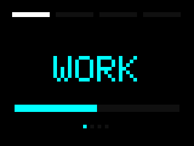

# Arcade Agent Desk

A small desk display for jobs running on your computer. It shows **WORK, DONE,
FAIL, WAIT or LOST** on a Scratch Arcade handheld, with a short notification tone.
The computer sends status numbers, never command text, source code or full logs.

[日本語](README.ja.md)



*Actual WASM replay with synthetic notices; not a handheld recording or real job video.*

[22-second demo](docs/media/demo.mp4) — edited host replay with a synthetic soundtrack; Japanese captions. Not handheld footage.

## Current status

The UDP bridge, local command runner, private pairing and paired WASM build work
on the host. Tests cover the real C app and Wasmtime, including authentication,
replay rejection and expiry. One ESP32-S3 handheld has also passed automated
status/render comparisons, real exit-code notifications, expiry and cleanup.
The install/connect/disconnect CLI is available. Two reconnect cycles preserved all
15 apps; 40 timed updates met the three-second observation deadline. Human
LCD, physical key and audio checks remain pending.

## Try the host tools

```sh
uv sync --locked
uv run --locked python -m arcade_agent_desk pair --key secrets/pairing.json
uv run --locked python -m arcade_agent_desk build \
  --sdk ../scratch-arcade-os --key secrets/pairing.json --output build/paired
uv run --locked python -m arcade_agent_desk run --key secrets/pairing.json \
  --timeout 60 -- uv run --locked python -m unittest discover -s tests
```

Builds require a clean OS checkout at
`3bb9548846505eac303927b9064c6a8d0eb44f79` and its pinned Zig toolchain
(`uv run --locked python tools/bootstrap.py` in that checkout).
Build output embeds your private pairing key: keep both the output and the key local.
The default bridge listens only on loopback. A real device needs an explicit LAN
bind address and the OS's configured UDP route; running a command alone does not
install or connect the device.

## Watch four jobs

An unreachable notification receiver does not cancel local jobs. Authentication and reconnection rules still apply.
`device_connected` records a received HELLO; it does not guarantee delivery of the last notification.
[Offline behavior](docs/offline-notifications.md).

```sh
uv run --locked python -m arcade_agent_desk watch \
  --key secrets/pairing.json --jobs examples/jobs.json
```

One bridge handles up to four explicit commands. The sample includes intentional
failure and timeout cases, so its exit status is 1. Copy it to a local, ignored
job file for real work. [Job format and boundaries](docs/daily-workflow.md).
No command or output text is sent to the handheld.

## Connect the handheld

Start from HOME with released keys. Use the same paired package and key as above.
The [connection guide](docs/daily-workflow.md#本体の接続と終了) covers private Wi-Fi
settings, detected USB port, explicit LAN bind, guarded installation and radio cleanup.
These commands add only the owned app; they do not install device firmware.

## Run the tests

Install [uv](https://docs.astral.sh/uv/) and Clang, then:

```sh
uv sync --locked
uv run --locked python -m unittest discover -s tests -v
# With the pinned OS checkout and toolchain available:
uv run --locked python -m unittest discover -s tests/integration -v
```

Python is pinned to 3.12.13. Host tests need no GPU, credentials or connected device.
They compile the real C app with a mock OS and test real short-lived subprocesses.

## Design

- A 40-byte authenticated notification fits the OS's 64-byte UDP limit.
- A durable launch generation rejects packets from a previous app launch.
- Sequence numbers reject replay and reordering; expired messages show LOST.
- Up to four numbered tasks can be selected with the direction buttons.
- The host runner reports the actual exit status and bounds command execution.

WAIT is an explicit library event; the command runner does not guess when an AI
tool is waiting for approval. Use one bridge per device. A restarted device app
may rebind a changed UDP address after the old peer expires (five seconds).

The app targets the [Scratch Arcade OS](https://github.com/ayutaz/scratch-arcade-os)
ABI 2 SDK. Production pairing keys stay local and must not be committed.
The public test key is only a fixture, not a deployable pairing credential.

Development details: [host validation](docs/validation.md),
[device validation](docs/device-validation.md), [protocol](docs/protocol.md).
Code is licensed under [Apache-2.0](LICENSE).

Release packaging: [source archive and checksum](docs/releases.md). No tagged release has been published yet.
